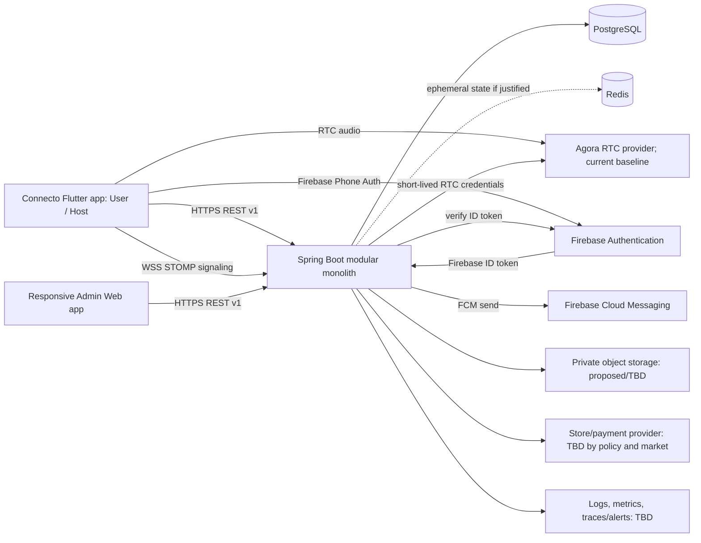

# Connecto — System Architecture

**Target:** modular monolith first; proposed design, not currently implemented architecture.

## Stack assessment and constraints

Retain Flutter/Dart Android, Java 21/Spring Boot, Spring Security/JPA, PostgreSQL, STOMP/WebSocket, and the existing Agora integration as baseline. Evaluate (do not assume migration to) LiveKit/WebRTC. Redis is present as a dependency; use it only for explicitly designed ephemeral state/cache/coordination. Do not add Kafka absent demonstrated asynchronous throughput or durability requirements. No existing admin web stack exists; choose one after admin scope and team constraints are approved.

## Context diagram

## Module boundaries

Identity/session; profile/privacy; discovery/connections; messaging; notification; call orchestration; RTC provider adapter; voice rooms; wallet/ledger/payment adapters; host/earnings/payout; safety/moderation; admin/audit; operations. Modules own their domain services and repositories. Cross-module effects use explicit application services/domain events; avoid direct table ownership by another module. Introduce outbox + worker for durable external side effects when required. Never publish payment/call settlement solely through a best-effort in-memory event.

## Communication patterns

- REST `/api/v1/**` for commands and query resources; authenticated bearer access tokens.
- WSS `/ws/v1` (transport/path to be finalized) for authorized transient events; send only event IDs/metadata, not secrets or payment authority.
- Push notifications carry opaque resource IDs and minimal text; opening the app must reauthorize and fetch fresh state.
- RTC media is provider-to-provider/client, not proxied through Spring. Backend controls authorization and lifecycle metadata; provider webhooks/callbacks are verified if used.
- PostgreSQL transactions are the source of truth for identity, relationships, call state, ledger and audit. Redis is non-authoritative.

## Data flows and trust boundaries

1. Flutter uses Firebase Phone Authentication to verify the phone and obtain a Firebase ID token. The backend validates that token (including signature, issuer, audience, expiry and verified phone), links the Firebase UID to the account, then issues the application's own short-lived access token and revocable/rotatable refresh session. A client-side Firebase success response alone never authorizes application APIs.
2. The backend sends minimal FCM notification payloads to registered device tokens; clients refetch authorized state from the API.
3. Discovery filters authorized profile projection; exact location never appears in general profile/API responses.
4. Call command authenticates actor, verifies eligibility/blocks/presence/funds, locks or atomically claims callee, creates state, and emits invitation through durable/observable mechanism.
5. Acceptance commits state transition before issuing participant-scoped, time-limited RTC credentials. Client events cannot determine billable time.
6. Server-authoritative connection evidence and configured billing policy create idempotent ledger entries; reconciliation handles late/missing events.
7. Purchase/payout integrations verify provider-side transaction and idempotency before financial posting; outbox/reconciliation detects drift.

## Deployment shape (proposed)

Start with stateless Spring Boot replicas behind TLS load balancer, managed PostgreSQL with backups/HA, Redis only if needed, private object storage, secrets manager, and observability. WebSocket load balancing must support connection affinity or a deliberately selected broker/relay architecture before horizontal scaling. Store migrations run as a controlled deployment step, never concurrent uncontrolled Hibernate DDL. AWS is preferred by brief, but region/services/costs/data residency remain decisions; no specific resource size is asserted.

## Availability/scaling decisions

Define launch traffic, concurrency, geographic latency, RTO/RPO, retention, and provider limits before sizing. Scale discovery with indexes and bounded/paginated queries; consider geospatial indexing only after location is approved. Separate services only when measured scaling/ownership/fault isolation demands it.

## Failure handling

DB unavailable: fail closed on financial/call authorization; no fake balance or successful response. Redis unavailable: degrade only non-authoritative presence/cache; determine safe behavior. Push unavailable: preserve invitation and retry/expire. WebSocket lost: resubscribe, fetch authoritative state, deduplicate event ID. RTC failure: call state and billing reconciliation use server/provider evidence, never client timer. External purchase/payout timeout: persist pending provider transaction and reconcile; never credit twice.

## Security and operations

Threat model includes token theft, IDOR, abusive calls/messages, STOMP destination spoofing, replayed payment receipts, duplicate settlement, location leakage, admin abuse, and provider outage. Require rate limits, authorization at command and subscription/message handler, audit trail for privileged/financial actions, secret rotation, redaction and alerts. See [SECURITY-GUIDELINES.md](SECURITY-GUIDELINES.md).

## Evolution and decision log

No API or database contract is final until Phase 00 decisions and review. Use additive versioned contracts, migration tests and backward-compatible rollout. Firebase Phone Authentication and FCM are the selected implementation direction, subject to project setup and India production verification. Other decisions needing owner approval include market/age obligations, roles, friend consent, monetization, verification, admin frontend framework, AWS region, and availability targets.
